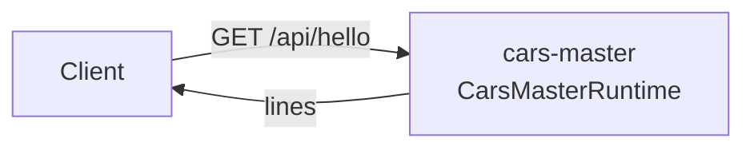

<!--
@license
Copyright (c) rljson

Use of this source code is governed by terms that can be
found in the LICENSE file in the root of this package.
-->

# The first server: hello over HTTP

## Motivation

- The cars example app keeps its master data in a domain of its own,
  apart from sign-in and the browser API
- This repo is the runtime of that domain: a server that runs on its own
  and may carry heavy dependencies
- Before any master data exists, the repo has to prove that it can be
  built, tested, packed into a container and reached over HTTP
- So its first release answers one request: `GET /api/hello`

## Strategy

- Set the repo up the way every rljson repo is set up: the rljson DNA
  for guides and skills, the TypeScript toolchain for build and tests
- Keep the first feature tiny, so the setup is what gets tested
- Run as an app of its own, the container `cars-master`; others reach it
  over HTTP only, never as a linked package
- Keep the package private (`"private": true`), so it is never published
  to npm

## Implementation: the setup

- `gg dna init` and `gg dna add @rljson/dna-rljson` brought the guides,
  the skills for Claude and the GitHub checks
- vite builds the package, vitest tests it with 100 % coverage, eslint
  checks the code and its JSDoc
- `index.jsonc` describes the repo for the agents that choose repos

## Implementation: the server

- `hello()` returns `Hello from cars-master-runtime`
- `CarsMasterRuntime` is a plain `node:http` server:
  - `GET /api/hello` answers `{"lines":["Hello from cars-master-runtime"]}`
  - `GET /health` answers `ok`
  - every other request answers 404
- `start()` reads `PORT` from the environment, 3000 by default
- The tests start the server on a free port and call it with `fetch`

## Implementation: the container

- A multi-stage Dockerfile on `node:22-alpine` builds the package and
  keeps only the production dependencies
- The container runs as uid 1000 and calls `start()`
- `az acr build` builds it in the registry, tag `<version>-<sha>`

## Result

- The container `cars-master` runs and answers its hello line over HTTP

## Open Points

- The repo holds no master data yet; the next steps replace the greeting
  with the real domain
