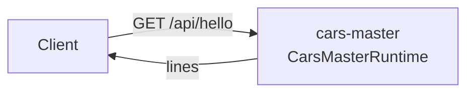

<!--
@license
Copyright (c) rljson

Use of this source code is governed by terms that can be
found in the LICENSE file in the root of this package.
-->

# Der erste Server: Hello über HTTP

## Motivation

- Die cars-Beispiel-App hält ihre Stammdaten in einer eigenen Domäne,
  getrennt von Anmeldung und Browser-API
- Dieses Repo ist die Runtime dieser Domäne: ein Server, der für sich
  läuft und schwere Abhängigkeiten tragen darf
- Bevor es Stammdaten gibt, muss das Repo zeigen, dass es sich bauen,
  testen, in einen Container packen und über HTTP erreichen lässt
- Sein erstes Release beantwortet deshalb eine Anfrage: `GET /api/hello`

## Strategie

- Das Repo so aufsetzen wie jedes rljson-Repo: die rljson-DNA für
  Anleitungen und Skills, die TypeScript-Toolchain für Build und Tests
- Das erste Feature winzig halten, damit der Aufbau geprüft wird
- Als eigene App laufen, der Container `cars-master`; andere erreichen
  ihn nur über HTTP, nie als eingebundenes Paket
- Das Paket privat halten (`"private": true`), damit es nie auf npm
  veröffentlicht wird

## Umsetzung: der Aufbau

- `gg dna init` und `gg dna add @rljson/dna-rljson` brachten die
  Anleitungen, die Skills für Claude und die GitHub-Prüfungen
- vite baut das Paket, vitest testet es mit 100 % Abdeckung, eslint
  prüft den Code und sein JSDoc
- `index.jsonc` beschreibt das Repo für die Agenten, die Repos auswählen

## Umsetzung: der Server

- `hello()` liefert `Hello from cars-master-runtime`
- `CarsMasterRuntime` ist ein einfacher `node:http`-Server:
  - `GET /api/hello` antwortet `{"lines":["Hello from cars-master-runtime"]}`
  - `GET /health` antwortet `ok`
  - jede andere Anfrage antwortet 404
- `start()` liest `PORT` aus der Umgebung, standardmäßig 3000
- Die Tests starten den Server auf einem freien Port und rufen ihn mit
  `fetch` auf

## Umsetzung: der Container

- Ein mehrstufiges Dockerfile auf `node:22-alpine` baut das Paket und
  behält nur die Produktionsabhängigkeiten
- Der Container läuft als uid 1000 und ruft `start()` auf
- `az acr build` baut ihn in der Registry, Tag `<version>-<sha>`

## Ergebnis

- Der Container `cars-master` läuft und beantwortet seine Hello-Zeile über
  HTTP

## Offene Punkte

- Das Repo hält noch keine Stammdaten; die nächsten Schritte ersetzen den
  Gruß durch die echte Domäne
